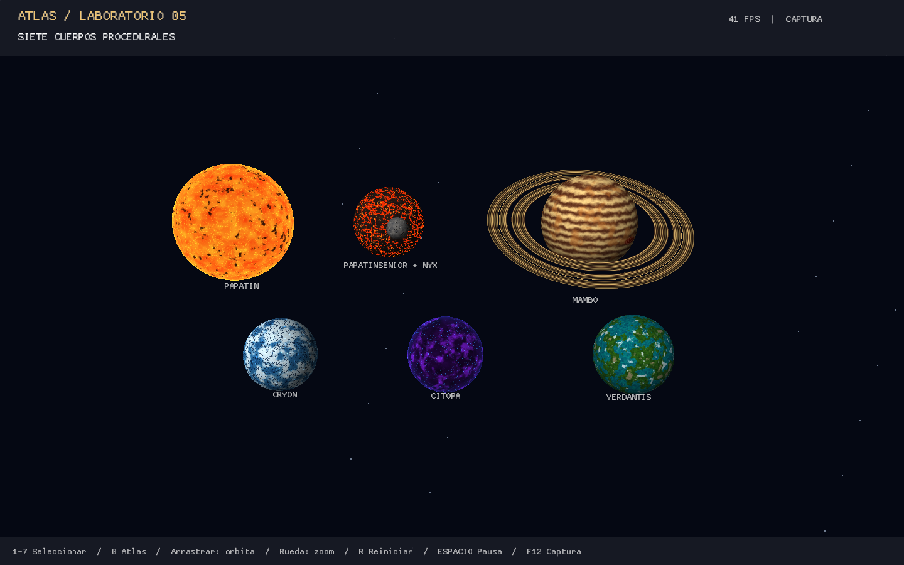
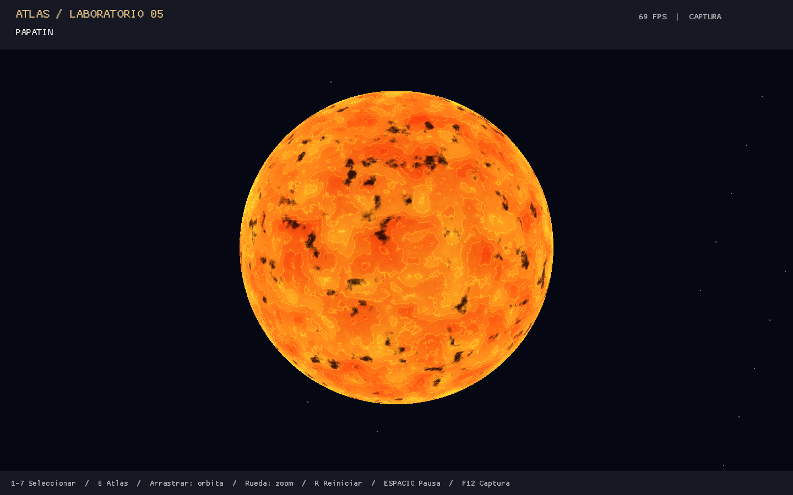
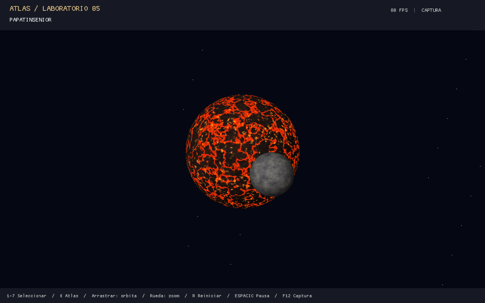
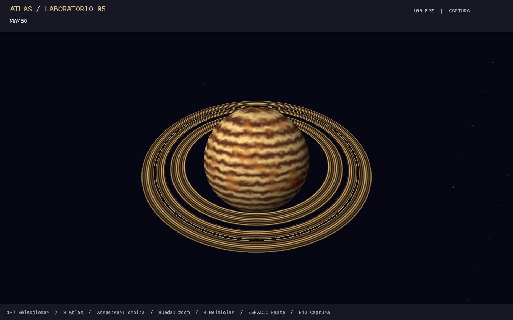
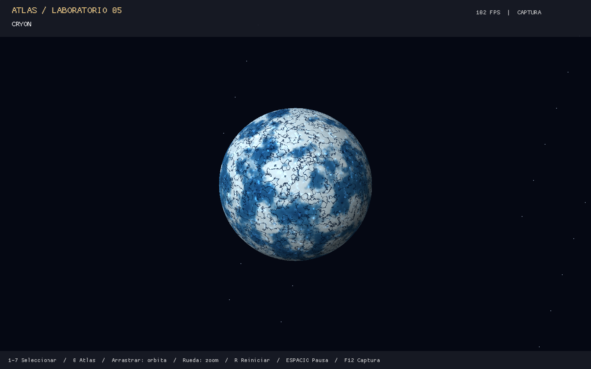
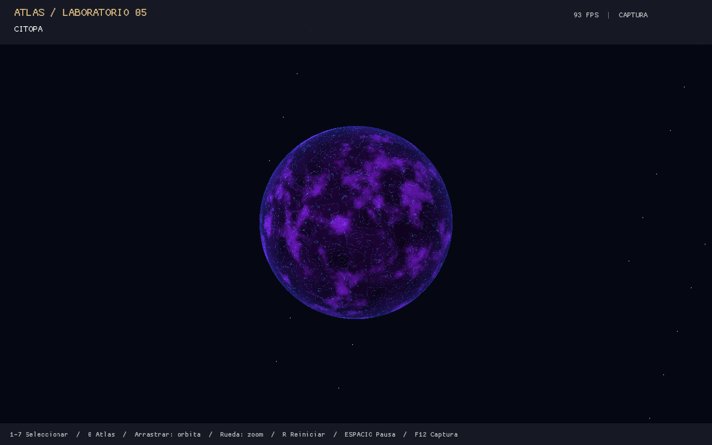
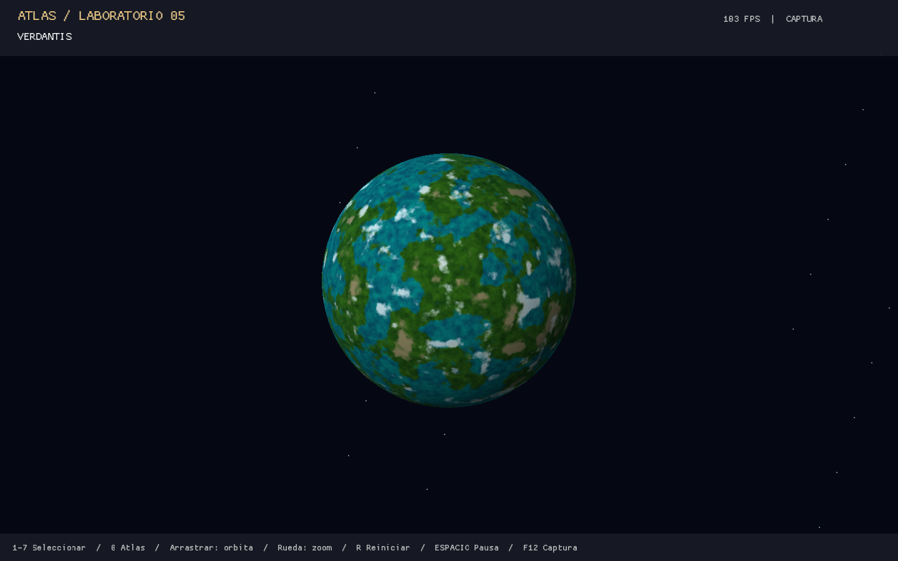
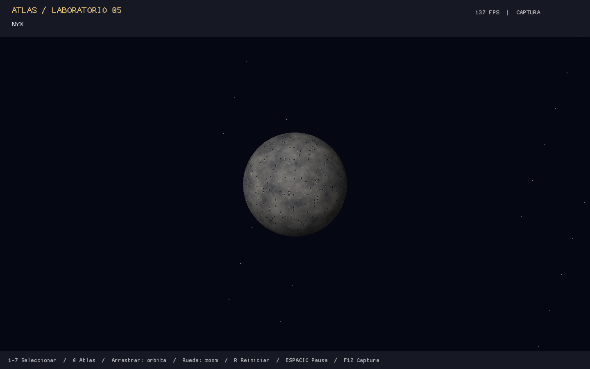

# Lab-5-Shaders

Atlas de mundos procedurales — Laboratorio 5 de gráficos por computadora.

**Estudiante:** Emilio Chen · **GitHub:** EmilioChenf · **Correo académico:** che24841@uvg.edu.gt

Seis cuerpos principales, una luna y anillos independientes, generados con Rust,
geometría matemática y shaders GLSL. **No hay texturas de imágenes ni mapas de
color en las superficies.**



## Tecnologías y compatibilidad

- Rust 2021, Cargo y Macroquad 0.4.16, fijado con `Cargo.lock`.
- Macroquad/Miniquad proporciona ventana, entrada, GPU y cámara. Se escogió como
  alternativa a Raylib para evitar una instalación nativa adicional y mantener
  el proyecto pequeño y portable. No se utiliza Raylib ni Blender.
- Backend OpenGL de escritorio, shaders `#version 120` (GLSL de escritorio 1.20). Requiere un controlador compatible
  con OpenGL 2.1 o superior; no apunta a WebGL ni a Metal. Los shaders se
  compilaron y ejecutaron realmente en Mesa/Linux limitado a OpenGL 2.1 y GLSL 1.20.
- Fuente del shader embebida con `include_str!`: el ejecutable no necesita buscar
  archivos GLSL relativos a su ubicación. Los PNG de `docs/` no son recursos de
  ejecución. La fuente de la interfaz la proporciona Macroquad.

## Instalación y ejecución en Windows

Instalar Rust desde <https://rustup.rs/> y Visual Studio Build Tools 2022 con
**Desktop development with C++**, MSVC y Windows SDK. Alternativamente, desde
PowerShell con `winget`:

```powershell
winget install --id Rustlang.Rustup --exact
winget install --id Microsoft.VisualStudio.2022.BuildTools --exact --override "--wait --passive --add Microsoft.VisualStudio.Workload.VCTools --includeRecommended"
```

Abrir una nueva terminal después de instalar. Usar el checkout existente; si
no existe en la máquina, clonarlo una sola vez:

```powershell
git clone https://github.com/EmilioChenf/Lab-5-Shaders.git
cd Lab-5-Shaders
rustup default stable-msvc
rustup component add rustfmt clippy
cargo build --release --locked
cargo run --release --locked
```

Si ya se está dentro del repositorio, comenzar directamente con `rustup` y
`cargo`. También se puede ejecutar `target\release\lab-5-shaders.exe`.
La ventana inicial mide 1440×900 y permite cambiar su tamaño. Se recomienda
1280×720 o más. **Windows no se ejecutó en esta sesión**: la validación real se
hizo en Linux; estos son los pasos de instalación para el backend Windows de
Macroquad, no una afirmación de prueba en Windows.

En Linux se necesita Rust, un compilador/enlazador C, X11 y un controlador OpenGL.
Con esas herramientas instaladas se usan los mismos comandos `cargo`.

## Los seis cuerpos y sus capas

`shaders/body.frag` contiene una biblioteca común de hash, value noise trilineal
y fBM de cinco octavas. `Kind` selecciona una composición distinta para cada
cuerpo. Cada fila describe cuatro contribuciones que modifican el color final:

| Cuerpo | Capa 1 | Capa 2 | Capa 3 | Capa 4 |
|---|---|---|---|---|
| **PAPATIN** | Células de plasma amarillo/naranja | Manchas solares oscuras por máscara fBM | Filamentos calientes | Borde incandescente con intensidad pulsante |
| **PAPATINSENIOR** | Basalto oscuro con variación mineral | Ceniza y grano superficial | Grietas rojas de lava mediante isocontornos fBM | Bolsas naranjas de incandescencia animada |
| **MAMBO** | Bandas crema y marrones | Cinturones ocres turbulentos | Gran tormenta oval rojiza con remolinos concéntricos | Nubes finas por ruido de alta frecuencia |
| **CRYON** | Glaciares azules | Nieve blanca y casquetes | Fracturas oscuras | Brillos de hielo y borde azulado |
| **CITOPA** | Terreno oscuro violeta | Nebulosas energéticas animadas | Venas eléctricas cian | Halo azul en el limbo |
| **VERDANTIS** | Océanos turquesa | Continentes verdes | Cordilleras minerales | Nubes blancas en movimiento |

Las posiciones locales llegan del vertex shader sin rotar: los detalles se
mantienen pegados a la superficie mientras `Spin` rota su geometría. Las normales
se rotan con el mismo ángulo. `Center`, `Radius` y `Tilt` colocan cada objeto;
`Time` anima patrones y rotaciones, y `Eye` permite calcular el borde luminoso.
Los cuerpos no emisivos reciben iluminación direccional coherente con ambiente;
Papatin es emisivo y Papatinsenior/Citopa mezclan emisión según sus máscaras. No es una
simulación física de iluminación desde la posición de Papatin ni un efecto bloom.

## Anillos y luna

**Mambo** tiene una malla anular separada, radios locales 1.35–2.15 e inclinación
0.38 radianes. Su fragment shader usa únicamente distancia radial para bandas
minerales y huecos. Los huecos finos se recortan con `discard`; el agujero central
es geometría real. Depth testing y escritura de profundidad producen oclusión
correcta con el planeta. El anillo conserva la orientación respecto a Mambo.

**Nyx** es otra esfera, de radio 0.29, que orbita Papatinsenior con radio horizontal
1.75 y altura 0.25. Tiene regolito, tierras altas, depresiones y bordes de cráteres
por ruido y celdas locales. No es una marca dibujada sobre Papatinsenior. La luna y los
anillos se muestran también en las vistas individuales de sus planetas.

Los planetas rotan a velocidades distintas. Se mantiene su distribución en el
atlas para facilitar la comparación; únicamente Nyx se traslada en órbita.
Las escalas y distancias son artísticas, no astronómicas.

## Controles

| Entrada | Acción |
|---|---|
| `1`–`7` | Seleccionar Papatin, Papatinsenior, Mambo, Cryon, Citopa, Verdantis o Nyx |
| `0` | Volver al atlas |
| Arrastrar con botón izquierdo | Orbitar alrededor del objetivo |
| Rueda del mouse | Zoom, limitado para conservar estabilidad |
| `R` | Restablecer la cámara de la vista actual |
| `Espacio` | Pausar/reanudar rotaciones, órbita y tiempo de shaders |
| `F12` | Guardar captura PNG de la vista actual |
| `Escape` | Salir |

La cámara sigue operativa en pausa. La interfaz muestra selección, controles y
FPS. La vista individual oculta los otros sistemas para inspeccionar el shader. La tecla `7` centra la cámara en Nyx mientras sigue su órbita. Mambo tiene un encuadre más amplio para mostrar sus anillos completos.

## Capturas reales

Se obtuvieron ejecutando el binario release en Xorg/Mesa, sin composiciones ni
imágenes generadas. Para regenerar las ocho vistas automáticamente:

```powershell
cargo run --release --locked -- --capture-all
```

El programa espera ocho fotogramas por vista, captura el atlas y los siete cuerpos
y termina. En este modo fija el tiempo de simulación a 3 segundos para obtener
encuadres estables y reproducibles; el modo interactivo mantiene las animaciones.

Para **compilar, ejecutar y verificar automáticamente** formato PNG, resolución,
contenido de superficie, imágenes diferentes y actualización de los ocho archivos:

```powershell
python -m pip install Pillow
python scripts/capture_all.py
```

Este verificador necesita Rust en PATH y una sesión gráfica activa; en Linux
puede utilizarse un servidor X11 virtual con Mesa. Las ocho imágenes de este
README ya fueron generadas y verificadas: no hay capturas pendientes. F12 guarda
`docs/screenshots/atlas.png` o `docs/screenshots/NOMBRE.png`, relativo al directorio
de ejecución; **sobrescribe la imagen anterior de esa vista**. Ejecutar desde la
raíz para actualizar las evidencias del README. Una carpeta sin permisos de
escritura puede impedir la captura; usar una ubicación escribible.

| Papatin | Papatinsenior y Nyx |
|---|---|
|  |  |

| Mambo y anillos | Cryon |
|---|---|
|  |  |

| Citopa | Verdantis |
|---|---|
|  |  |

### Nyx, luna independiente



Su shader combina regolito gris moteado, tierras altas, depresiones oscuras de
cráter y bordes elevados claros. Conserva la superficie y la órbita de la luna;
no utiliza los patrones violetas del planeta Citopa.

## Arquitectura

```text
Cargo.toml / Cargo.lock     Dependencias reproducibles
src/main.rs                Punto de entrada
src/app.rs                 Ventana, eventos, UI y capturas
src/camera.rs              Cámara orbital
src/geometry.rs            Esfera indexada y anillo sin texturas
src/bodies.rs              Catálogo y órbita de Nyx
src/shaders.rs             Materiales GLSL y uniformes
src/render.rs              Renderizado de cuerpos y sistemas seleccionados
shaders/body.vert          Transformaciones y coordenadas locales
shaders/body.frag          Ruido y siete composiciones de superficie
shaders/rings.frag         Bandas y huecos de los anillos
docs/screenshots/          Ocho capturas reales
docs/VALIDATION.md          Evidencias y límites de las pruebas
scripts/capture_all.py     Compilación, captura y verificación automática
scripts/check.sh           Validación de Rust en sistemas POSIX
scripts/validate_input.py  Prueba gráfica opcional de eventos X11
```

La esfera tiene 96×64 segmentos, normales analíticas y 36 864 índices; el búfer de
índices se amplía a 40 000 para evitar truncamiento. Los radios se escalan de
forma uniforme, por lo que las normales pueden normalizarse después de rotar.
Las texturas de superficie de `Mesh` son `None`. El renderer establece todos los
uniformes por objeto antes de dibujar y vuelve al material por defecto para UI.

## Pruebas y resultados

```powershell
cargo fmt --check
cargo check --locked
cargo test --locked
cargo clippy --all-targets --locked -- -D warnings
cargo build --release --locked
```

Resultado real: los cinco comandos completaron correctamente, **8 pruebas
aprobadas, 0 fallidas**, y Clippy sin advertencias. Se ejecutó la aplicación,
se compilaron los shaders en la GPU Mesa por software y se generaron los ocho
PNG. La prueba XTest validó selección, F12, pausa/reanudación, arrastre, reset,
zoom, retorno al atlas y salida. Ver [detalle y limitaciones](docs/VALIDATION.md).
El redimensionamiento a 1280×720 también se comprobó con eventos X11.
`cargo check --locked --target x86_64-pc-windows-gnu` pasó, pero la ejecución
nativa en Windows y otras GPU permanecen **NO VERIFICADO**.

## Evidencia de la rúbrica

| Criterio | Implementación y evidencia |
|---|---|
| Creatividad | Seis composiciones diferenciadas; galería real anterior |
| Cuatro capas por cuerpo principal | Tabla de capas y ramas de `body.frag` |
| Estrella, rocoso y gaseoso | Papatin, Papatinsenior y Mambo |
| Tres planetas adicionales | Cryon, Citopa y Verdantis |
| Anillos | Malla anular y shader independiente de Mambo |
| Luna | Esfera Nyx y órbita comprobada alrededor de Papatinsenior |
| Interacción y animación | Cámara, selección, rotaciones, tiempo y controles comprobados |
| Evidencia visual | Atlas y siete vistas individuales capturadas del programa |

`target/`, binarios y archivos temporales están excluidos de Git. Las capturas
PNG se versionan porque son evidencia solicitada, no dependencias del render.

## Identidad e historial Git

Los commits nuevos usan `EmilioChenf <che24841@uvg.edu.gt>` y mensajes en español.
GitHub asocia los commits según los correos verificados de la cuenta; configurar
Git localmente no verifica ese correo en GitHub. La revisión de los 19 commits
anteriores y la estrategia sin pérdida están en [HISTORIAL.md](docs/HISTORIAL.md).
No se ha reescrito el historial publicado ni usado force push.

## Auditoría final contra la rúbrica

[Informe completo](docs/AUDITORIA.md): inventario de seis cuerpos principales y
una luna, evaluación razonada de creatividad, pruebas ejecutadas, correcciones,
28 capas con archivo, expresión, uniformes y píxeles afectados, y límites de la
verificación. **VERDANTIS es planeta y NYX es luna**, conforme a la aclaración
expresa del usuario; la luna no se contabiliza como planeta adicional.

Para repetir la auditoría de capas con una sesión gráfica activa y Pillow:

```powershell
python scripts/audit_layers.py
```

El script compila, regenera las ocho capturas, comprueba el rechazo de GLSL
inválido y crea 35 renders en `docs/audit/layers/`: por cuerpo, una vista completa
y cuatro vistas omitiendo una contribución cada vez. `docs/audit/layers.json`
registra los 28 cambios observados. La imagen con las cuatro capas activas debe
ser idéntica a la captura de producción en el área sin interfaz. `LayerMask`
siempre vale `(1,1,1,1)` en ejecución normal; no se han sustituido los diseños.
El modo `--audit-layers` también puede ejecutarse directamente desde el binario.
